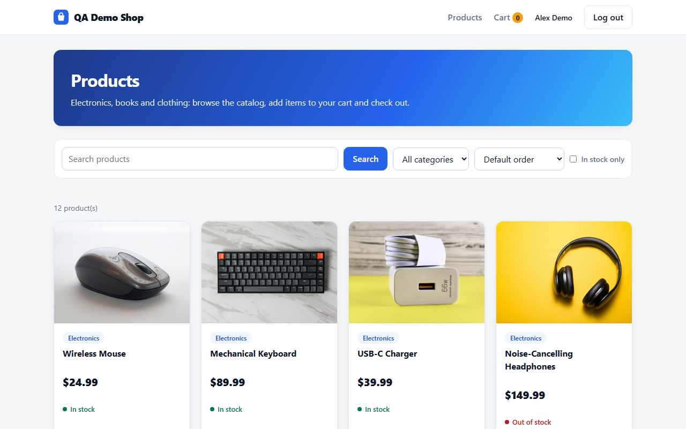
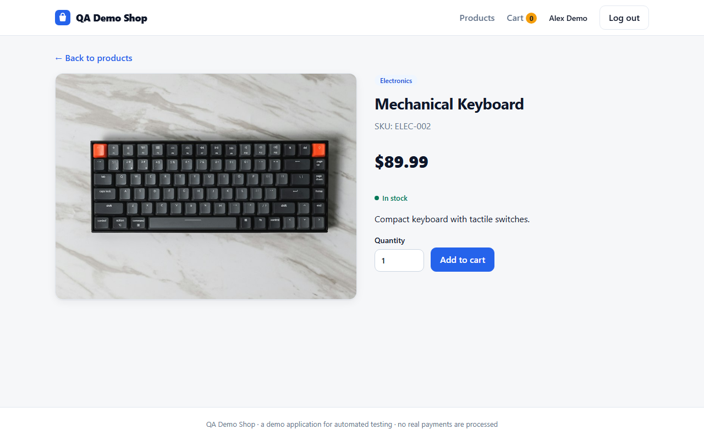
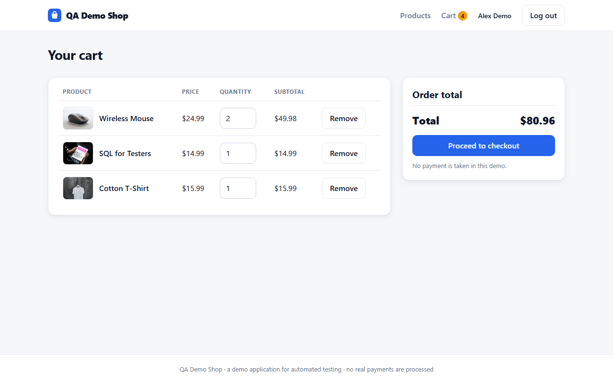
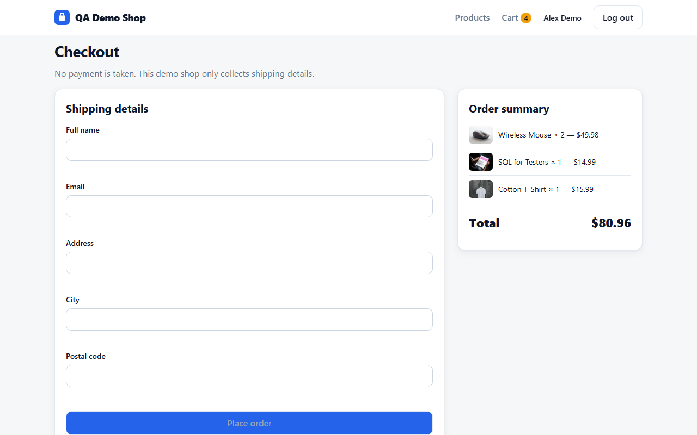
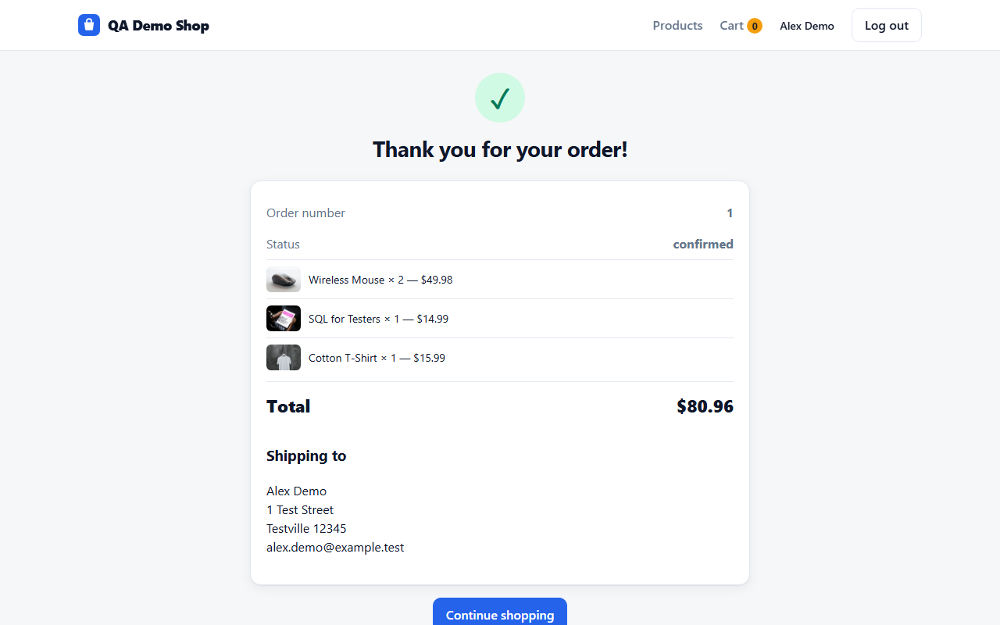
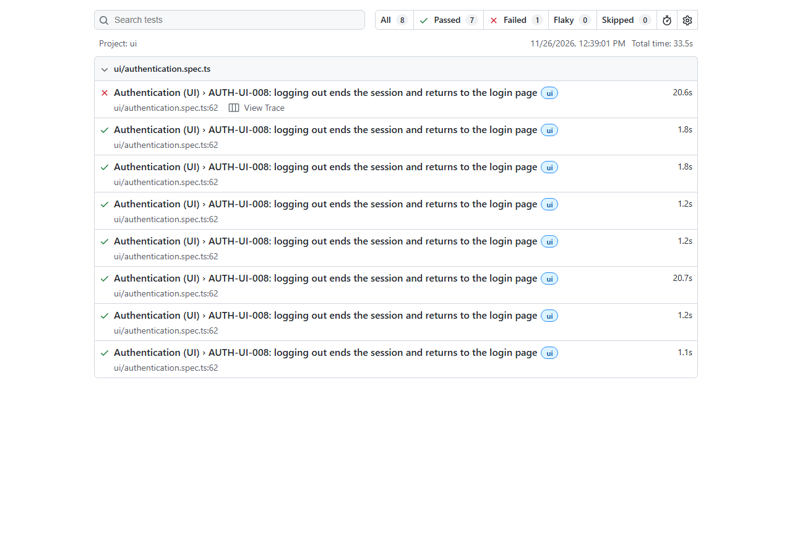
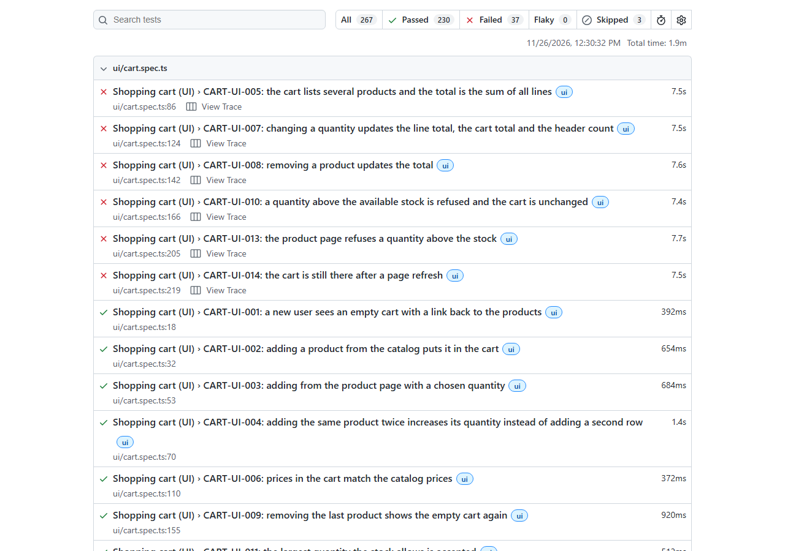
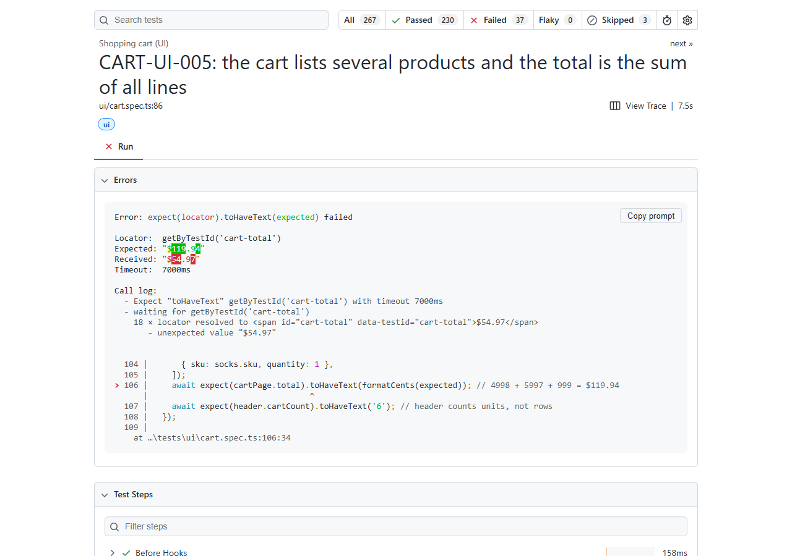
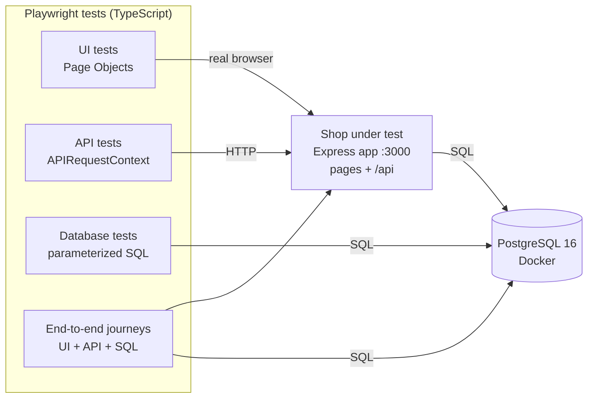

# E-Commerce QA Automation Framework

[](https://github.com/BENOURO/ecommerce-qa-automation/actions/workflows/playwright.yml)


A complete automated QA framework that tests a web shop **from the user interface, through the API, down to the PostgreSQL database**, and checks that all three layers agree with each other.

It is a portfolio project: the shop under test is a small application I built so that I own every layer (UI, API and database) and can test them honestly. The tests are written against a written specification ([`docs/APP-SPEC.md`](docs/APP-SPEC.md)), the way a QA engineer would test a product they did not write.

## Results at a glance

| Measure | Result |
|---|---|
| Automated test executions | **270** (UI 93, end-to-end 5, API 116, database 53, isolated stock 3) |
| Documented test cases | **202**, with IDs, priorities, steps and expected results: [`docs/TEST-CASES.md`](docs/TEST-CASES.md) |
| Run time | about 30 to 40 seconds (2 parallel workers); the GitHub Actions job takes about 1 minute 15 seconds |
| CI | GitHub Actions: starts PostgreSQL, runs everything, publishes the HTML report |
| Defect-detection proof | 10 deliberately injected bugs, **10 of 10 caught**: [`docs/SEEDED-BUGS.md`](docs/SEEDED-BUGS.md) |
| Real defects found while building | 4 (see [below](#real-defects-the-tests-found)) |

## Screenshots

The shop under test:

| Catalog | Product page |
|---|---|
|  |  |

| Cart | Checkout validation | Order confirmation |
|---|---|---|
|  |  |  |

The HTML test report (all passing), and the report of a run against the deliberately broken shop:

| All 270 passing | Seeded defects switched on |
|---|---|
|  |  |

What a failure looks like: the cart total ignores quantities, and the test shows the expected and received values, with a trace and screenshot attached.



## What is tested

| Area | UI | API | Database |
|---|---|---|---|
| Authentication: login, logout, protected pages, session persistence and expiry, authorization (401/403) | yes | yes | yes (hashing, uniqueness) |
| Products: catalog, details, search, filters, sorting, unavailable products | yes | yes | yes (records, API/SQL consistency) |
| Shopping cart: add, remove, quantities, totals, stock limits, persistence | yes | yes | |
| Checkout: validation, order summary, totals, confirmation, double submit | yes | yes | yes (orders, order items, prices, cascades) |
| Cross-layer journeys: one user flow verified in UI, API and database | 5 journeys | | |
| Database rules: unique, check, not-null and foreign-key violations | | | yes |

Every test case is listed with its priority, steps and expected result in [`docs/TEST-CASES.md`](docs/TEST-CASES.md).

## Architecture



- **Playwright starts and stops the shop** by itself (`webServer` in `playwright.config.ts`).
- **Each test creates its own user** (unique email, random password) and removes it afterwards, so tests are independent and safe to run in parallel.
- **A separate "isolated" project** runs last and alone, for tests that measure exact stock numbers.
- **Safety:** the database connection refuses any database whose name does not end in `_test`.

## Technologies

TypeScript, Playwright (UI and API), Node.js 20+, PostgreSQL 16 (Docker Compose), Express (shop under test), GitHub Actions.

## Prerequisites

- [Node.js](https://nodejs.org) 20 or newer
- [Docker Desktop](https://www.docker.com/products/docker-desktop/) (for PostgreSQL)
- Git

## Installation

```
git clone https://github.com/BENOURO/ecommerce-qa-automation.git
cd ecommerce-qa-automation
npm install
npx playwright install chromium
```

Create your local settings file (Windows `cmd`; use `cp` on macOS and Linux):

```
copy .env.example .env
```

Open `.env` and set `DB_PASSWORD` and `TEST_USER_PASSWORD` to any local test values.

### Environment settings

| Variable | Meaning |
|---|---|
| `BASE_URL`, `APP_PORT` | Where the shop runs (default `http://localhost:3000`). Change both if the port is taken. |
| `DB_HOST`, `DB_PORT`, `DB_NAME`, `DB_USER`, `DB_PASSWORD` | PostgreSQL connection. `DB_NAME` must end in `_test`. |
| `TEST_USER_EMAIL`, `TEST_USER_PASSWORD`, `ADMIN_EMAIL` | The seeded customer and administrator. |
| `SESSION_TTL_SECONDS` | Session lifetime (default 1800). |
| `ENABLE_TEST_ENDPOINTS` | Set to `true` by the test runner; exposes an endpoint that expires a session. |
| `BUGS` | Switches on seeded defects (see below). Empty means a healthy shop. |

No real credentials are used anywhere. `.env` is never committed.

## Start the database

Docker Desktop must be running.

```
npm run db:up
npm run db:reset
```

`db:up` starts PostgreSQL in a container. `db:reset` creates the tables and loads the seed data (it can be run again at any time to return to a clean state). Stop it with `npm run db:down`.

## Run the tests

| Command | What it runs |
|---|---|
| `npm test` | Everything (270 tests) |
| `npm run test:smoke` | Quick checks only |
| `npm run test:ui` | Browser tests |
| `npm run test:api` | API tests |
| `npm run test:db` | Database tests |
| `npm run test:e2e` | Cross-layer journeys |
| `npm run test:isolated` | Exact-stock tests |
| `npm run typecheck` | TypeScript check |

To run the shop by hand and look at it: `npm run app`, then open http://localhost:3000.

## Reports

Every run writes an HTML report to `reports/html`, with totals, passed, failed and flaky counts, duration, error details, and screenshots and traces for failures. Open it with:

```
npm run report
```

In GitHub Actions the report is uploaded as the **playwright-report** artifact, and a results table is shown at the top of each run.

## Seeded defects: proof that the tests catch bugs

Ten realistic defects can be switched on one at a time (for example: the cart total ignores quantities, search becomes case-sensitive, password hashes leak in the admin list, a double-sent order creates two orders). All are off by default.

```
npm run test:bugs       # all ten on; many tests fail on purpose; report in reports/html-bugs
npm run report:bugs     # open that report
npm run bug-matrix      # each defect alone, whole suite, writes docs/SEEDED-BUGS.md
```

Result: **10 of 10 defects detected**, each by at least one test that failed again on a confirmation re-run. See [`docs/SEEDED-BUGS.md`](docs/SEEDED-BUGS.md).

### Real defects the tests found

These were not injected. They were bugs in my own shop, found by the tests while writing them:

1. **Empty cart still showed its table, total and checkout button**: a CSS rule overrode the HTML `hidden` attribute.
2. **Double-clicking "Place order" created two orders**: two requests read the same cart. Fixed on the server (one order at a time per customer) and in the button.
3. **A leading space in the postal code failed validation, a trailing space did not**: values are now trimmed before validating.
4. **The login form ignored a click made before the page finished loading**: the submit handler was attached too late. Found through an intermittently failing test.

## CI/CD

[`.github/workflows/playwright.yml`](.github/workflows/playwright.yml) runs on every push and pull request: install dependencies, install Chromium, type-check, start a PostgreSQL service, seed it, run all tests, write a summary, and upload the HTML report (and, on failure, screenshots, videos and traces). A manual "Run workflow" option also runs the seeded-defect demo.

## Project structure

```
app/            the shop under test (Express): routes, sessions, pages, seeded defects
database/       schema, seed data, connection, queries, rollback-only transactions
tests/
  ui/           browser tests
  e2e/          cross-layer journeys
  api/          API tests
  database/     PostgreSQL tests
  isolated/     tests that need the shop to themselves
pages/          Page Objects (login, header, products, cart, checkout, confirmation)
fixtures/       reusable Playwright fixtures (fresh user, logged-in page, page objects)
utils/          environment, test data, catalog helpers, API helpers
scripts/        bug matrix, CI summary, documentation and screenshot generators
docs/           app specification, test cases, seeded defects, troubleshooting
```

## Design decisions worth knowing

- **Page Object Model and fixtures** keep tests short and readable; selectors live in one place.
- **Web-first assertions**: no sleeps anywhere. Playwright waits and retries.
- **Test data is generated**, never hardcoded: unique users with random passwords.
- **Database tests use parameterized SQL** and a rolled-back transaction for rule-breaking tests, so they leave nothing behind.
- **Money is stored in integer cents**, and tests check it in every layer.
- **Documentation is checked**: `npm run docs:check` fails if a test has no entry in the test case document.

## Known limitations

- The shop under test is my own small demo application, not a third-party product. That is deliberate (it allows real database and API testing), but it means defects are limited to what I built.
- Carts and sessions are kept in memory and are lost when the shop restarts. There is no payment step and no registration page (registration exists as an API).
- Tests run in Chromium only. Other browsers can be added as projects in `playwright.config.ts`.
- Product photos come from Unsplash ([`docs/IMAGE-CREDITS.md`](docs/IMAGE-CREDITS.md)) and are illustrative.
- On one Windows development machine, the shop's Node process froze for about 10 seconds at random when many browsers ran at once. Cause unidentified; mitigated by limiting workers to 2 ([`docs/TROUBLESHOOTING.md`](docs/TROUBLESHOOTING.md)). It was not observed in the GitHub Actions run, nor in a run from the author's own terminal (one run each, so this is not proof it cannot happen).
- Running the suite with `--repeat-each` needs care for the isolated project (see the troubleshooting notes).

## License

MIT, see [`LICENSE`](LICENSE).
